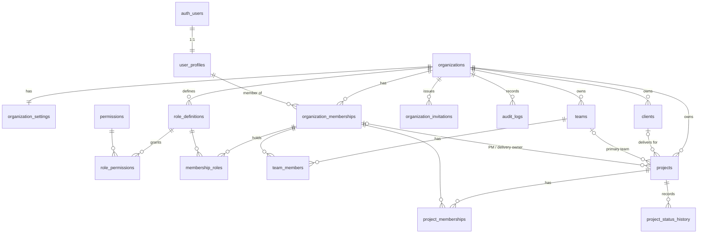

# Stride — Database

_Last updated: 2026-10-26 (Phase 1). Source of truth: `supabase/migrations/`._

## 1. Conventions

- UUID primary keys (`gen_random_uuid()`), `timestamptz` audit columns, `updated_at` maintained by trigger.
- **Every tenant-owned row carries `organization_id`.** Parents expose `unique (id, organization_id)`
  and children reference **both** columns, so a row can never point at a parent in another tenant
  (enforced by foreign keys, not just policy).
- **RLS is enabled on every table.** `anon` has no privileges. `authenticated` gets only explicit
  table/column grants declared in the migration. Default privileges are revoked so new tables start
  with no API access.
- Governed columns (project `status`, `health`, `archived_at`; membership `status`; roles) are not
  writable through table privileges; they change only through SECURITY DEFINER RPCs.
- Helper functions live in the non-exposed `private` schema where they should not be callable via
  the API; RPCs callable by users live in `public` with explicit `grant execute`.
- Soft delete by `archived_at` for business records (clients, teams, projects). Hard delete is
  reserved for tenant offboarding (cascade from `organizations`).
- Migration filenames: `YYYYMMDDHHMMSS_description.sql`.

**Every new migration must:** enable RLS on new tables, declare grants explicitly, add an audit
trigger for business entities, add pgTAP coverage, and regenerate types (`pnpm db:types`).

## 2. Phase 1 entity model

| Table | Purpose | Notes |
|---|---|---|
| `organizations` | Tenant | `is_demo` drives the demo banner |
| `organization_settings` | Time zone, currency, week start, `health_stale_after_days` | 1:1 |
| `user_profiles` | Display name, email | Created by trigger on `auth.users` insert |
| `organization_memberships` | User ↔ org, `status` active/suspended, job title | Suspension removes all access |
| `permissions` | Global permission catalogue | Read-only reference |
| `role_definitions` / `role_permissions` | Per-org roles, copied from `private.role_templates` | Custom roles later |
| `membership_roles` | Role assignments | Audited |
| `organization_invitations` | Pending invitations by email + role keys | Accepted via RPC on sign-in |
| `audit_logs` | Append-only change log | Update/delete blocked by trigger |
| `clients` | Minimal client record | Contacts/contracts in Phase 4 |
| `teams`, `team_members` | Organizational teams | |
| `projects` | Project record + lifecycle + health | Budget fields deliberately absent (Phase 5, separate access policy) |
| `project_memberships` | Project team, role, indicative allocation | Grants project read access |
| `project_status_history` | Lifecycle and health changes | Written only by trigger |
| `departments` | Flat departments with an optional head | Added 2026-10-27; audited |

`organization_memberships` also carries `department_id` and `manager_membership_id` (reporting line;
a trigger rejects cycles, a check rejects self-management, composite FKs keep both in-tenant).
`organization_invitations` tracks `email_sent_count` / `email_last_sent_at`.

## 3. Functions

| Function | Kind | Purpose |
|---|---|---|
| `is_org_member(org)` / `has_permission(org, perm)` / `my_permissions(org)` | RPC, definer | Caller's own membership/permissions |
| `can_read_project(project)` / `can_act_on_project(project, perm)` | RPC, definer | Resource-level checks |
| `is_valid_project_transition(from, to)` | immutable | Lifecycle state machine (14 transitions) |
| `create_organization(name, slug)` | RPC | Bootstraps org, roles, admin membership (rate-limited) |
| `invite_member` / `revoke_invitation` / `accept_pending_invitations` | RPC | Invitation workflow |
| `set_member_roles` / `set_membership_status` | RPC | Role + status admin with last-admin guard |
| `transition_project_status` / `set_project_health` / `set_project_archived` | RPC | Governed project changes with reasons |
| `create_role` / `update_role` / `delete_role` | RPC | Custom roles; system roles immutable; audited permission diffs |
| `record_invitation_email_sent` | RPC | Records an invitation email send |
| `private.is_assigned_to_client_project()` | definer | Confidential-client visibility |
| `private.prevent_reporting_cycle()` | trigger | Keeps reporting lines a tree |
| `private.validate_organization_settings()` | trigger | Rejects unknown IANA time zones |
| `private.audit_row_change()` | trigger | Generic diff audit |
| `private.projects_before_write()` | trigger | Lifecycle validation, timestamps |
| `private.projects_record_history()` | trigger | Status/health history |

Reasons for governed changes are passed to triggers through the transaction-local setting
`dhos.change_reason` (set inside the RPC).

## 4. Retention and deletion

| Data | Policy (Phase 1) |
|---|---|
| Business records | Soft delete (`archived_at`); restorable |
| Audit logs, status history | Append-only; removed only when the organization is deleted |
| User accounts | Deleting an auth user cascades profile and memberships; audit `actor_id` is set null |
| Organizations | Hard delete cascades all tenant data (offboarding; operator-only, no UI) |

Configurable retention windows and legal-hold arrive in Phase 8.

## 5. Logical model for later phases

The full logical model in the master brief (workforce, delivery, governance, finance, AI and
automation tables) is the target. Each phase adds its tables with the conventions above; overlapping
concepts are unified rather than duplicated (e.g. a single `raid_items` table with a type column
may replace separate risks/assumptions/issues/dependencies tables — to be decided by ADR in Phase 4).
