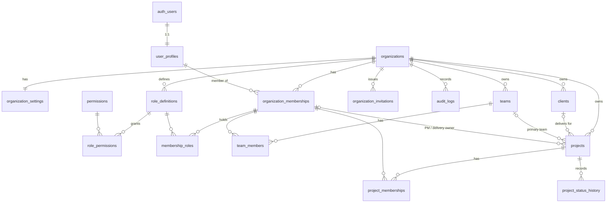

# Stride — Database

_Last updated: 2026-11-01 (Phase 3). Source of truth: `supabase/migrations/`._

## 1. Conventions

- UUID primary keys (`gen_random_uuid()`), `timestamptz` audit columns, `updated_at` maintained by trigger.
- **Every tenant-owned row carries `organization_id`.** Parents expose `unique (id, organization_id)`
  and children reference **both** columns, so a row can never point at a parent in another tenant
  (enforced by foreign keys, not just policy).
- **RLS is enabled on every table.** `anon` has no privileges. `authenticated` gets only explicit
  table/column grants declared in the migration. Default privileges are revoked so new tables start
  with no API access.
- Governed columns (project `status`, `health`, `archived_at`; membership `status`; roles) are not
  writable through table privileges; they change only through SECURITY DEFINER RPCs.
- Helper functions live in the non-exposed `private` schema where they should not be callable via
  the API; RPCs callable by users live in `public` with explicit `grant execute`.
- Soft delete by `archived_at` for business records (clients, teams, projects). Hard delete is
  reserved for tenant offboarding (cascade from `organizations`).
- Migration filenames: `YYYYMMDDHHMMSS_description.sql`.

**Every new migration must:** enable RLS on new tables, declare grants explicitly, add an audit
trigger for business entities, add pgTAP coverage, and regenerate types (`pnpm db:types`).

## 2. Phase 1 entity model

| Table | Purpose | Notes |
|---|---|---|
| `organizations` | Tenant | `is_demo` drives the demo banner |
| `organization_settings` | Time zone, currency, week start, `health_stale_after_days` | 1:1 |
| `user_profiles` | Display name, email | Created by trigger on `auth.users` insert |
| `organization_memberships` | User ↔ org, `status` active/suspended, job title | Suspension removes all access |
| `permissions` | Global permission catalogue | Read-only reference |
| `role_definitions` / `role_permissions` | Per-org roles, copied from `private.role_templates` | Custom roles later |
| `membership_roles` | Role assignments | Audited |
| `organization_invitations` | Pending invitations by email + role keys | Accepted via RPC on sign-in |
| `audit_logs` | Append-only change log | Update/delete blocked by trigger |
| `clients` | Client record | Contacts and contracts added in Phase 4 |
| `teams`, `team_members` | Organizational teams | |
| `projects` | Project record + lifecycle + health | Budget fields deliberately absent (Phase 5, separate access policy) |
| `project_memberships` | Project team, role, indicative allocation | Grants project read access |
| `project_status_history` | Lifecycle and health changes | Written only by trigger |
| `departments` | Flat departments with an optional head | Added 2026-10-27; audited |

### Phase 2 additions

| Table | Purpose |
|---|---|
| `programs` | Groups of projects (`projects.program_id`) |
| `project_milestones`, `project_baselines` | Milestones with `baseline_due_date`; immutable baseline snapshots |
| `workflow_states`, `workflow_transitions` | Per-org states (category todo / in_progress / done, WIP limit, default) and optional rules |
| `work_items`, `work_item_counters` | Unified hierarchy with keys `<CODE>-<n>`; counters hidden from the API |
| `work_item_dependencies`, `work_item_comments`, `work_item_links`, `work_item_activity` | Relationships, discussion, external links, trigger-written history |
| `sprints`, `sprint_daily_stats` | Sprint lifecycle and trigger-maintained burndown data |
| `project_status_reports` | Immutable reports with a metrics snapshot (counts only for internal work) |

Key functions: `allowed_parent_types`, `take_project_baseline`, `start_sprint`, `complete_sprint`,
`set_work_item_archived`, `can_read_work`; triggers `work_items_before_write` (keys, parent / sprint /
transition rules, completion stamp), `work_items_record_activity`, `work_items_refresh_sprints`,
`prevent_blocking_cycle`, `workflow_states_guard`. `work_items` is in the `supabase_realtime` publication.

### Phase 3 additions (workforce)

| Table | Purpose |
|---|---|
| `work_calendars`, `holidays` | Working weekdays (ISO 1–7), hours per day, one default per org; holidays per calendar. `organization_memberships.work_calendar_id` overrides the default |
| `leave_types`, `leave_balances` | Per-org types (paid, needs approval, yearly allowance or untracked); granted days per person, type and year |
| `leave_requests` | Dated requests; `days` computed by trigger from the calendar; status pending / approved / rejected / cancelled |
| `attendance_records`, `attendance_corrections` | One record per person per day (server clock); corrections reviewed by manager or HR |
| `timesheets`, `time_entries` | Weekly sheets (Monday start) with draft → submitted → approved / returned; entries by category, project and optional work item |
| `resource_allocations` | Dated person-to-project allocation percentages; supersede `project_memberships.allocation_percent` |

Key functions: `request_leave`, `review_leave_request`, `cancel_leave_request`, `set_leave_balance`,
`grant_annual_leave_allowances`, `check_in`, `check_out`, `request_attendance_correction`,
`review_attendance_correction`, `cancel_attendance_correction`, `attendance_exceptions`,
`submit_timesheet`, `recall_timesheet`, `review_timesheet`, `timesheet_compliance`,
`capacity_overview`, `team_availability`, `leave_milestone_conflicts`, `set_member_calendar`,
`set_default_calendar`; private helpers `can_view_hr_of`, `can_review_hr_of`,
`can_view_timesheets_of`, `can_review_timesheets_of`, `member_working_days`, `leave_remaining`;
triggers `leave_requests_before_write`, `timesheets_before_write`, `time_entries_before_write`.
New organizations get a default calendar and Annual, Sick and Unpaid leave types
(`private.seed_workforce_defaults`). See [ADR-0008](DECISIONS/ADR-0008-workforce-model.md).

### Phase 5 additions (finance)

| Table | Purpose |
|---|---|
| `rate_card_lines` | Hourly cost and bill rate per job title, effective-dated, never edited (`finance.manage` only) |
| `member_cost_rates` | A person's own cost rate, effective-dated; overrides the card (`finance.manage` only) |
| `project_budgets`, `budget_lines` | Versioned budgets by cost category; one draft and one approved baseline per project; approved content frozen |
| `cost_entries` | Append-only non-labour actuals; corrected by a reversing entry |
| `forecast_entries` | Expected non-labour spend per category and month; editable |
| `contract_values` | Contract value and billing model, kept apart from `client_contracts` for its own policy |
| `revenue_lines` | Planned revenue (forecast) until recognised (fact, locked) |

Key functions: `start_budget`, `approve_budget`, `reverse_cost_entry`, `recognise_revenue`,
`project_financials` (one row per visible project: facts and forecasts separately),
`project_monthly_actuals`; private helpers `can_see_project_finance`, `cost_rate_for`; triggers
`project_budgets_before_write`, `budget_lines_before_write`, `cost_entries_before_insert`,
`revenue_lines_before_write`, `audit_finance_change` (redacts amounts). See
[ADR-0010](DECISIONS/ADR-0010-finance-model.md).

### Phase 6 additions (AI agents)

| Table | Purpose |
|---|---|
| `agent_org_settings` | One row per organization: master switch (off by default), provider, model, monthly token cap, optional prices. No credentials |
| `agent_definitions` | One row per agent per organization: key, enabled, active version. Seeded for every organization by trigger |
| `agent_versions` | Immutable prompt, model and parameters; a change is a new version |
| `agent_eval_runs` | Verdict of each golden-case evaluation; the latest one for a version gates its activation |
| `agent_executions` | The execution log with tokens, latency and estimated cost; written only by RPC, readable only by the requester |
| `agent_approvals` | Proposed actions awaiting a person other than the requester; closed set of action types |

RPCs: `start_agent_execution` (all gates), `finish_agent_execution`, `decide_agent_approval`,
`complete_agent_approval`, `record_agent_eval`, `activate_agent_version`, `set_agent_enabled`,
`agent_usage` (aggregate, no content). Four permissions (`agent.read|run|approve|manage`). See
[ADR-0011](DECISIONS/ADR-0011-ai-agents.md).

### Phase 7 additions (automation)

| Table | Purpose |
|---|---|
| `outbox_events` | One row per domain event, written by triggers in the same transaction as the change; claimed, fanned out and marked processed by the worker |
| `notifications` | Per-recipient inbox; unread repeats collapse by `dedupe_key`; email status tracked per row |
| `notification_preferences` | In-app and email choice per person per category |
| `webhook_endpoints`, `webhook_secrets` | Outbound endpoints; signing secrets in a separate table with no session grants |
| `webhook_deliveries` | One row per (endpoint, event) with attempts, backoff and final status |
| `workflow_rules`, `workflow_rule_versions`, `workflow_runs` | Rules, their immutable history and what each run did (once per rule and event) |
| `scheduled_jobs`, `job_runs`, `scheduler_heartbeat` | Five per-organization jobs seeded by trigger, their run log, and the platform's last tick |
| `integration_connections`, `integration_links`, `integration_sync_runs` | Mock-adapter connections, work-item ↔ external-issue links, sync history |

Worker RPCs (`service_role` only): `claim_outbox_events`, `fail_outbox_event`, `rule_candidates`,
`apply_workflow_rule`, `fan_out_event`, `claim_webhook_deliveries`, `complete_webhook_delivery`,
`claim_pending_emails`, `complete_notification_email`, `claim_due_jobs`, `run_scheduled_job`,
`record_job_result`, `record_heartbeat`, `integration_sync_inputs`, `apply_integration_status`,
`record_integration_sync`, `due_integration_connections`. Operator RPCs: `create_webhook_endpoint`,
`rotate_webhook_secret`, `redeliver_webhook`, `run_job_now`. Retention (30 days events and deliveries,
90 days read notifications and logs) is the `retention` job; the audit log is never purged. See
[ADR-0012](DECISIONS/ADR-0012-automation.md).

### Phase 4 additions (governance)

| Table | Purpose |
|---|---|
| `raid_items` | Unified risks, assumptions, issues and dependencies (`type`); risks carry probability and impact (generated `score`); resolving, closing or accepting needs a note |
| `decisions` | Proposed → accepted / rejected → superseded; recorded decisions are locked by trigger |
| `project_actions` | Owned, dated actions, optionally linked to a RAID item or decision of the same project |
| `escalations`, `escalation_evidence` | Escalations with a recipient, severity and response deadline; append-only evidence; created only by `raise_escalation` |
| `change_requests` | Draft → submitted → approved / rejected → implemented (or withdrawn); content locked after draft |
| `releases`, `release_gates` | Releases with quality gates (default five); approval requires every required gate passed or waived |
| `client_contacts`, `client_contracts` | Under a client; visibility and edit rights inherited from the client (terms and dates; the value is in `contract_values`) |
| `documents`, `document_versions` | Versioned documents; versions are append-only; `internal` or `client` visibility |

Key functions: `raise_escalation`, `acknowledge_escalation`, `resolve_escalation`, `submit_change_request`,
`withdraw_change_request`, `decide_change_request`, `implement_change_request`, `record_gate_result`,
`transition_release`, `release_readiness`, `create_document`, `add_document_version`; private helpers
`can_see_client`, `can_manage_client`, `membership_can_read_project`, `org_today`; triggers
`raid_items_before_write`, `decisions_before_write`, `project_actions_before_write`,
`change_requests_before_write`, `releases_before_write`, `releases_after_insert` (seeds default gates),
`document_versions_immutable`. See [ADR-0009](DECISIONS/ADR-0009-governance-model.md).

`organization_memberships` also carries `department_id` and `manager_membership_id` (reporting line;
a trigger rejects cycles, a check rejects self-management, composite FKs keep both in-tenant).
`organization_invitations` tracks `email_sent_count` / `email_last_sent_at`.

## 3. Functions

| Function | Kind | Purpose |
|---|---|---|
| `is_org_member(org)` / `has_permission(org, perm)` / `my_permissions(org)` | RPC, definer | Caller's own membership/permissions |
| `can_read_project(project)` / `can_act_on_project(project, perm)` | RPC, definer | Resource-level checks |
| `is_valid_project_transition(from, to)` | immutable | Lifecycle state machine (14 transitions) |
| `create_organization(name, slug)` | RPC | Bootstraps org, roles, admin membership (rate-limited) |
| `invite_member` / `revoke_invitation` / `accept_pending_invitations` | RPC | Invitation workflow |
| `set_member_roles` / `set_membership_status` | RPC | Role + status admin with last-admin guard |
| `transition_project_status` / `set_project_health` / `set_project_archived` | RPC | Governed project changes with reasons |
| `create_role` / `update_role` / `delete_role` | RPC | Custom roles; system roles immutable; audited permission diffs |
| `record_invitation_email_sent` | RPC | Records an invitation email send |
| `private.is_assigned_to_client_project()` | definer | Confidential-client visibility |
| `private.prevent_reporting_cycle()` | trigger | Keeps reporting lines a tree |
| `private.validate_organization_settings()` | trigger | Rejects unknown IANA time zones |
| `private.audit_row_change()` | trigger | Generic diff audit |
| `private.projects_before_write()` | trigger | Lifecycle validation, timestamps |
| `private.projects_record_history()` | trigger | Status/health history |

Reasons for governed changes are passed to triggers through the transaction-local setting
`stride_ces.change_reason` (set inside the RPC).

## 4. Retention and deletion

| Data | Policy (Phase 1) |
|---|---|
| Business records | Soft delete (`archived_at`); restorable |
| Audit logs, status history | Append-only; removed only when the organization is deleted |
| User accounts | Deleting an auth user cascades profile and memberships; audit `actor_id` is set null |
| Organizations | Hard delete cascades all tenant data (offboarding; operator-only, no UI) |

Operational data (events, deliveries, read notifications, job and sync logs) follows windows an
administrator sets between 7 and 3650 days (`set_retention_windows`; defaults 30, 90 and 90). A
**legal hold** (`set_legal_hold`, reason required) makes the retention job delete nothing for that
organization until it is lifted. The audit log is never purged. Security settings live in
`organization_settings` (`require_dual_approval`, `require_mfa`, `legal_hold*`) and are changed only
through `set_security_controls` and `set_legal_hold`; privileged-role requests are
`role_grant_requests`. See ADR-0014.

**Delivery metrics (ADR-0015).** `project_metric_entries` (one value per project, metric and Monday),
`project_report_settings` (recipients, weekly and monthly switches; readable only by people who can
publish for the project) and `metric_report_runs` (one generated report per project, kind and period:
the email queue and history). Written only by `save_metric_entries`, `save_report_settings`, the
`metrics_reports` job and the `service_role` functions `claim_pending_reports` and
`complete_report_run`; read through `project_metrics`. `private.metric_catalogue()` lists the 30
metrics, their ranges and how weeks combine.

## 5. Logical model for later phases

The full logical model in the master brief (workforce, delivery, governance, finance, AI and
automation tables) is the target. Each phase adds its tables with the conventions above; overlapping
concepts are unified rather than duplicated (e.g. a single `raid_items` table with a type column
may replace separate risks/assumptions/issues/dependencies tables — to be decided by ADR in Phase 4).
